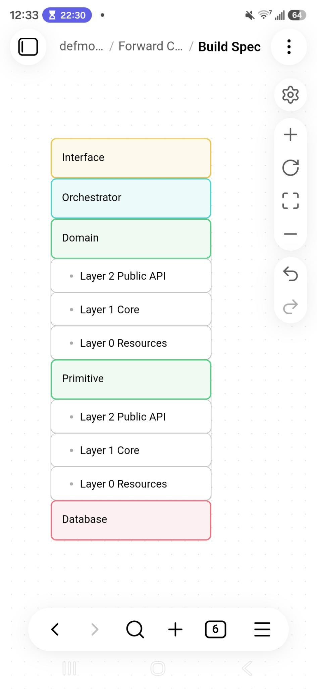

# Library Seed

The starting point for every library in the Domain and Primitive layers. This file and `layers.jpg` live in their own repo, `library_seed`, cloned next to every library, and aren't copied into them: a library refers to this file as `../library_seed/library-seed.md`, from its README and its layering test. To start a library, replace `MyLib`, `:my_lib`, `svc_ml_`, and `my_lib_test` with the library's module name, app name, table prefix (Primitives only), and test database. Sections 1 to 5 are the spec the library must fit. Section 6 is seed code that already fits it: rename it, run its tests, then grow it.

Reference implementation: `object_manager`, a Primitive. Its spec, `object_manager/docs/superpowers/specs/2026-10-06-object-manager-design.md` §3 and §4, is a worked example of the layering and the startup sequence. The spec predates this document: its "L1 Domain logic" is L1 Core, "layer" there means sub-layer, and object_manager's layering test is §6.12 before `@drivers` became `@outside` and `@forbidden` was added.

---

## 1. The architecture



```
┌───────────────────────────┐
│ Interface                 │
├───────────────────────────┤
│ Orchestrator              │
├───────────────────────────┤
│ Domain                    │  each library: L2 Public API / L1 Core / L0 Resources
├───────────────────────────┤
│ Primitive (microservice)  │  each library: L2 Public API / L1 Core / L0 Resources
├───────────────────────────┤
│ Database                  │
└───────────────────────────┘
```

Five layers, top down:

| Layer | What it is |
|---|---|
| **Interface** | The system's entry points: the code that receives requests from outside (HTTP, a UI, a CLI) and hands them on. |
| **Orchestrator** | Coordinates work across Domain libraries. |
| **Domain** | The rules of one business area, built on Primitives. A Domain library owns no tables and holds no connection. |
| **Primitive (microservice)** | One self-contained capability with its own tables, such as `object_manager`. Microservice means a capability of its own, not a database of its own (§1.2). |
| **Database** | PostgreSQL itself: the server, and the tables the Primitives create in it. |

This document specifies Domain and Primitive libraries. Interface and Orchestrator are described only as far as the calling rule and the host application need.

### 1.1 The calling rule

Code in a layer calls only its own layer and the layer directly below it.

| Caller | May call |
|---|---|
| Interface | Interface, Orchestrator |
| Orchestrator | Orchestrator, Domain |
| Domain | Domain, Primitive |
| Primitive | Primitive, Database |

Nothing calls upward, and nothing skips a layer. So an Orchestrator never calls a Primitive, only Primitives contain SQL, own tables, and create them, and a Domain library reaches its data through Primitive calls.

### 1.2 The connection

The host application starts a Postgrex pool (or several, to one database) and gives every Primitive an MFA that returns one (§3.1). The pool is infrastructure the host hands out, not the Database layer, and a Primitive runs its SQL on it. A Domain library holds no connection: it forwards the `:conn` it was called with to its Primitive calls (§3.3). When several of them must be atomic, it asks the TransactionManager Primitive to start, or join, a transaction (§3.5), so a multi-step Domain operation commits or rolls back as a unit.

That only works when TransactionManager and every Primitive a Domain operation forwards its connection to share one database and one schema, because a transaction can't span databases and the tables are created in the connection's `current_schema()`. It is also why every Primitive takes a table prefix: the Primitives' tables sit side by side in one schema, and a configurable prefix lets two deployments, or two copies of one library's tables, share a database.

### 1.3 The host application

Each Domain and Primitive library runs as one instance per node, and none starts itself: a library has no `Application` module, and the host's supervision tree starts it, bottom up. The pool first, then the Primitives (TransactionManager among them), then the Domains, then whatever runs the Orchestrators and the Interface.

```elixir
children = [
  {Postgrex, name: MyApp.DB, database: "myapp", pool_size: 10},
  {TransactionManager, conn: {Function, :identity, [MyApp.DB]}},
  {ObjectManager, conn: {Function, :identity, [MyApp.DB]}, prefix: "svc_om_"},
  {MyLib, conn: {Function, :identity, [MyApp.DB]}, prefix: "svc_ml_"},
  {MyDomain, []}
]

Supervisor.start_link(children, strategy: :one_for_one)
```

Libraries find each other by registered name, so a restart of one doesn't require restarting the others; a call into a library that is restarting exits with `:noproc` (§4). A Primitive's startup reaches the database (§4), so the database must be reachable when the tree starts: OTP doesn't retry a child whose start function returns an error, it fails the host's start.

---

## 2. One library, three sub-layers

| Sub-layer | Namespace | Responsibility |
|---|---|---|
| **L2 Public API** | `MyLib`, plus public types such as `MyLib.Thing` | The functions callers use, including the lifecycle functions. Validates options (NimbleOptions) and argument types (guards), delegates to L1, and turns L1 results into public types. Holds the docs. |
| **L1 Core** | `MyLib.Core.*` | Rules and orchestration: algorithms, transaction boundaries, lock order, validation of values, with or without stored state (L2's guards check only types), and the library's process tree (the Supervisor and the Store Agent). Contains no SQL. |
| **L0 Resources** | `MyLib.Resources.*` | Everything that reaches outside the library: the database, or the libraries this one depends on (Primitives for a Primitive; Domain and Primitive libraries for a Domain library, §1.1). In a Primitive: SQL text, driver calls, row mapping, and table creation. In a Domain library: the adapters over the libraries it uses, TransactionManager among them. Contains no rules. |

### 2.1 The five rules

1. **Calls only go downward, one sub-layer at a time:** L2 → L1 → L0. L2 never calls L0 directly, and L0 never calls L1 or L2. Calls within a sub-layer are fine.
2. **Only L0 calls the database driver or another library of the architecture.** In a Primitive, only L0 calls Postgrex or DBConnection or contains SQL. In a Domain library, only L0 calls the Primitive and Domain libraries it depends on, and nothing in it calls the driver: a Domain library contains no SQL, holds no connection, and reaches transactions through TransactionManager (§3.5). One adapter module per dependency keeps that dependency's structs and errors in one place, so replacing it touches one module, and the layering test can enforce the rule. L1 decides where transactions begin and end, but opens them through an L0 wrapper: `MyLib.Resources.Repo.transaction/2` (§6.7) in a Primitive, the TransactionManager adapter (§6.13) in a Domain library. Utility libraries such as NimbleOptions are outside this rule; it is about who reaches the database and the architecture's other libraries.
3. **L0 returns plain Elixir values:** maps with strings, integers, binaries, and `DateTime`s. Driver-specific representations (for example Postgrex's 16-byte UUID binaries) and other libraries' structs never leave L0, and L1 passes plain values back down.
4. **L2 owns the public types.** L2 builds its public structs (`%MyLib.Thing{}`) from the plain maps L1 returns, so no lower sub-layer depends on L2.
5. **Only L2 is documented publicly.** L1 and L0 modules use `@moduledoc false`, so ExDoc shows only L2. L2 docs must not link to L1 or L0 modules; ExDoc warns about links to hidden modules.

`test/layering_test.exs` (§6.12) enforces rules 1, 2's call half, and 5's `@moduledoc` half from the compiled code. The rest is checked in code review (§7.2).

---

## 3. The connection contract

§3.1, §3.2's last paragraph, and §3.4 are about Primitives, the only libraries that hold a connection. §3.3 applies to every library, and §3.5 is how a Domain library gets a transaction without one.

### 3.1 Startup: the `:conn` MFA

A Primitive's `start_link/1` requires `:conn`, an MFA tuple `{module, function, args}`. `apply(module, function, args)` must return a Postgrex connection or pool: a pid, a registered name, or a `%DBConnection{}`. For a fixed pool name use `{Function, :identity, [MyApp.DB]}`, which returns the name itself; for anything dynamic, point it at your own function, such as `{MyApp.Database, :conn, []}`. It is an MFA rather than an anonymous function because an MFA keeps working across hot code reloads and can be written in config.

Validate it in L2 (§6.2): NimbleOptions' `:mfa` type lets `nil` through. A Domain library's `start_link/1` takes no `:conn`: it holds no connection (§3.5).

### 3.2 The Store

Every library starts an Agent, `MyLib.Core.Store`, registered under its module name, and every operation reads it first. One instance runs per node, public functions find the Store by name, and none of them takes an instance argument. A Primitive keeps the MFA there along with whatever other state it needs: the table prefix, SQL built once for that prefix, defaults, a cache. A Domain library's Store holds whatever state the library has, often nothing; reading it first keeps the lifecycle (§4) the same for both kinds, so a call while the library is stopped exits with `:noproc` either way.

The Store never runs database work for callers, so it can't become a bottleneck and can't block on a slow query. Keep per-call state out of it too: an `Agent.update/2` on every call would serialize callers.

On each call that doesn't pass `:conn`, a Primitive's L1 reads the state and applies the MFA **in the calling process** (`MyLib.Core.Store.repo/1`, §6.5). That matters when the MFA's target depends on the calling process, for example connection ownership in a test sandbox. Startup and background workers apply it in their own processes.

### 3.3 Per call: the `:conn` option

Every public function except `start_link/1`, `child_spec/1`, and `stop/0` takes a keyword list of options as its **last** argument, defaulting to `[]`, and accepts `:conn`. In a Primitive, the connection for the call is

```elixir
opts[:conn] || apply(m, f, a)
```

so `nil` is the same as leaving it out, and a caller can forward an optional connection. In a Domain library, `opts[:conn]` is forwarded as it is, `nil` included: to a single Primitive call as `conn:`, or to TransactionManager (§3.5), whose connection the Primitive calls inside the transaction then receive. Even with `:conn`, the library must be running: a Primitive's Store supplies the rest of the configuration, and a Domain library reads its Store first so that the same holds (§3.2).

**Joining the caller's transaction.** When `:conn` is the `conn` received inside `Postgrex.transaction/3`, the call runs as part of that transaction:

- A function that runs several statements calls `Postgrex.transaction/3` on that `conn`, through `Repo.transaction/2` (§6.7). DBConnection runs it inline, as part of the caller's transaction, with no `BEGIN` and no savepoint. A function that runs one statement runs it directly on `conn`. Either way, everything the call writes commits or rolls back with the caller's transaction, and no other connection sees it before then.
- The library never begins, commits, or rolls back a transaction of its own on a caller's `conn`, never calls `DBConnection.rollback/2`, and uses no savepoints: a rollback inside a nested call would doom the caller's whole transaction, and the flat model keeps every expected error returnable as a value.
- Expected conditions such as `{:error, :not_found}` are decided before anything is written and returned as values. The caller's transaction stays usable.
- A database error aborts the caller's transaction, which is PostgreSQL's rule. The call returns `{:error, exception}`, and the caller's `Postgrex.transaction/3` then returns `{:error, _}`. After a failed single-statement call, the caller's next statement on `conn` fails with `Postgrex.Error` (`in_failed_sql_transaction`); after a failed multi-statement call, the nested `Postgrex.transaction/3` has marked the caller's transaction failed, so the next statement fails with `DBConnection.ConnectionError` and the connection is closed. Either way, the caller should do no further work on `conn` and just return.
- A raise, throw, or exit inside a nested `Postgrex.transaction/3` marks the caller's transaction failed the same way, even if the caller catches it. Argument errors raised in L2, before any database work, don't touch it.
- The caller's timeout and isolation level govern, and `now()` is the caller's transaction start time.
- A Domain library joins through the Primitives it forwards `conn` to, and through TransactionManager, which joins the transaction it is given instead of starting one (§3.5). The same rules then hold for it.

**Nested transactions across libraries.** This is what `:conn` buys. A Domain operation that needs several Primitive calls to be atomic runs them inside one transaction, which TransactionManager starts, or joins when the operation was called with `:conn` (§3.5). It forwards that transaction's connection to every Primitive call, so each Primitive's transaction nests inside it, flattened by DBConnection, and the whole operation is one unit of work:

```elixir
# MyLib.Core.Documents, L1 of a Domain library, behind MyLib.store_document/4.
# Transactions and Objects are its L0 adapters over TransactionManager and
# ObjectManager (§6.13).
def store(folder_uuid, data, metadata, opts) do
  Transactions.run(Store.conn(opts), fn conn ->
    # Reads and checks first, then the write: a normal return commits.
    with {:ok, _folder} <- Objects.info(conn, folder_uuid) do
      Objects.create(conn, data, metadata)
    end
  end)
end
```

Two things make that true, both of them requirements on TransactionManager (§3.5): a normal return commits, `{:error, atom}` included, and a `{:error, exception}` rolls back and comes back as it is. So a Domain operation makes every read and check before its first Primitive call that writes, and a write that can itself return an expected error can only be that first write. An expected error returned after a write would leave that write committed. An operation that can't be ordered that way is split, or its atomic part becomes one Primitive operation.

A Domain function called with `:conn` nests the same way inside its caller's transaction, so Domain → Domain → Primitive is still one unit of work. Orchestrators and the Interface hold no connection (only a Primitive does, §1.2) and have no `:conn` to pass: each Domain call an Orchestrator makes is its own unit of work. Work that must be one unit belongs in a Domain library, which may call other Domains (§1.1).

Passing a connection that isn't in a transaction (a pool name or pid) just uses it instead of the stored one, and the call runs in its own transaction as usual; so does a connection from `DBConnection.run/3`. Use `Postgrex.transaction/3`, not a `BEGIN` sent as SQL: DBConnection won't nest a transaction inside one it didn't start. A multi-statement call then tries to begin its own, and DBConnection finds the connection already in a transaction and closes it. Your transaction rolls back, and the call returns `{:error, %DBConnection.ConnectionError{}}`.

### 3.4 Transactions inside a Primitive

L1 decides the boundaries. An operation that runs several statements runs them in one `Repo.transaction/2`, so it is atomic; a single statement runs through `Repo.safely/1` (§6.7), and PostgreSQL runs it as its own transaction. Both turn `Postgrex.Error` and `DBConnection.ConnectionError` into `{:error, exception}` and rescue nothing else. A library that adds per-call configuration extends both the same way (object_manager's `safely/2` carries a deadline). A function may instead run a loop of single statements, each atomic on its own, when its docs say so, as object_manager's `purge_expired/1` deletes in batches; inside a caller's transaction every batch still joins it.

A multi-statement write to an existing row takes `SELECT ... FOR UPDATE` as its first statement, so writers to the same row take turns; a single-statement write locks the row through the `UPDATE` or `DELETE` itself, and zero rows affected is its expected error. Every `{:error, atom}` is decided before the first write, so it can be returned without rolling back. Inside `Repo.transaction/2`, the function returns `{:error, exception}` only for a database error that has already aborted the transaction, its own or a dependency's. `Repo.transaction/2` rolls back on any `{:error, exception}` (§6.7), so a callback whose normal result carries an exception struct wraps it in another tuple before returning.

On the stored connection, DBConnection's default `:timeout` of 15 seconds bounds each single statement and each whole `Repo.transaction/2`, row-lock waits included. A statement running at the deadline returns `{:error, %Postgrex.Error{postgres: %{code: :query_canceled}}}`; between statements the next call returns `{:error, %DBConnection.ConnectionError{}}`. A library that needs more adds a `:timeout` start option and a per-call `:timeout`, as object_manager does, and passes it to `Postgrex.query!/4` and `Postgrex.transaction/3`.

### 3.5 Transactions in a Domain library

A Domain library holds no connection, so it never begins a transaction itself. When one of its operations needs several Primitive calls to be atomic, it runs them inside a transaction that the TransactionManager Primitive starts and manages, reached through its L0 adapter `MyLib.Resources.Transactions` (§6.13). TransactionManager is a Primitive like any other: the host starts it with the `:conn` MFA, and its L0 is where `Postgrex.transaction/3` is called.

TransactionManager is not written yet, and this document doesn't fix its function signatures; the adapter is the one `lib/` module that changes when it exists; §6.13 says what changes in `mix.exs` and the test support. What the rules in §3.3 assume of a transaction it runs:

- It takes the operation's `:conn`, if any. A connection inside a caller's transaction is joined, so a Domain called inside a caller's transaction stays inside it; a pool name or pid gets a transaction started on it. Without one, it starts a transaction on its own stored connection.
- It hands the operation the connection to forward, as `conn:`, to every Primitive call inside.
- A normal return commits, `{:error, atom}` included. A raise, throw, or exit rolls back, or marks a joined transaction failed, and propagates.
- A `{:error, exception}` the operation returns, a Primitive's database error, rolls back, or marks a joined transaction failed, and comes back as it is, so the Domain's caller sees the real `Postgrex.Error`. (§6.7's `Repo.transaction/2` does the same inside a Primitive.)
- Its own `:timeout` governs the whole transaction; a Primitive's `:timeout` has no effect inside it (§3.4).

Until TransactionManager exists, a Domain library's multi-call operations can't run: the seed's adapter raises, and their tests are tagged `:skip` (§6.13). Single-call operations run now, forwarding `:conn` as it is.

---

## 4. Lifecycle

`start_link/1`, `child_spec/1`, and `stop/0` live in L2 and delegate to `MyLib.Core.Supervisor`.

**`start_link/1`:**

1. Validates the options with NimbleOptions. Invalid options raise `NimbleOptions.ValidationError`; they are programmer errors.
2. Returns `{:error, {:already_started, pid}}` if the library is already running on this node, before applying the MFA or touching the database. Two concurrent first starts can both pass this check; name registration in step 4 then settles which one wins, and the loser gets the same `{:error, {:already_started, pid}}` after having applied the MFA (in a Primitive).
3. In a Primitive: applies the MFA once, in the calling process, before any child starts, and runs `Resources.Schema.ensure/2` on that connection, creating missing tables and checking column names and types. A failure, including a raise, exit, or throw from the MFA, comes back as `{:error, reason}` with no process left behind. A direct caller can act on it and try again; under a host supervisor it fails the host's start (§1.3). A Domain library has nothing to apply or create and skips this step.
4. Starts `MyLib.Core.Supervisor` (`:rest_for_one`) with the Store first and any workers after it, so a Store restart also restarts the workers that depend on it, and a worker that restarts finds the Store already there.

**`child_spec/1`** is `type: :supervisor` and `restart: :transient`: after `stop/0` the library stays stopped, and the host restarts it only after an abnormal exit. It also stays stopped if `MyLib.Core.Supervisor` reaches its restart limit (more than 3 restarts in 5 seconds by default), because the supervisor then exits with `:shutdown`. So a worker never lets a database outage or a failing MFA crash it: it catches raise, exit, and throw around its work (and, in a Primitive, the MFA), logs, and retries at its next tick, as object_manager's `Core.Sweeper` does.

**`stop/0`** stops the supervisor. Stored data is untouched.

While the library is stopped, calls exit with `:noproc`. L2's guards and option validation run before the Store is consulted, so a bad argument raises instead. A value the library rejects with an `{:error, atom}` that needs no stored state (object_manager's `{:error, :invalid_uuid}` for a malformed UUID) is decided in L1 before the Store is read (`Store.repo/1` in a Primitive, `Store.conn/1` in a Domain library). So it too comes back while the library is stopped.

```
MyLib.Core.Supervisor   (Supervisor, :rest_for_one)
├── MyLib.Core.Store    (Agent: a Primitive's conn MFA + config + prebuilt SQL; a Domain library's state)
└── MyLib.Core.Worker   (optional GenServers; never crash on their work, or on the MFA in a Primitive)
```

---

## 5. Where things go

| Concern | Sub-layer | Notes |
|---|---|---|
| Option schemas (NimbleOptions) and argument guards | L2 | Generate option docs with `NimbleOptions.docs/1`. |
| Public structs and types | L2 | Built with `struct!/2` from L1's maps. |
| `start_link/1`, `child_spec/1`, `stop/0` | L2 | Validate, then delegate to `Core.Supervisor`. |
| The Store Agent, workers, the Supervisor | L1 | `MyLib.Core.Supervisor`, `MyLib.Core.Store`, and so on. |
| Transaction boundaries, locking, rules that need stored state | L1 | Through `Resources.Repo.transaction/2` in a Primitive; through the TransactionManager adapter in a Domain library (§3.5). |
| Value checks that need no stored state | L1 | Decided before the Store is read, returned as `{:error, atom}`. |
| Pure algorithms | L1 | Take callbacks for I/O (`read.(n)`, `write.(n, bin)`) so they can be unit-tested without a database. |
| SQL strings (Primitive) | L0 | Each Resources module owns the SQL for its own table, built once at startup for the prefix and kept in the Store. |
| Row mapping (Primitive) | L0 | Driver values → plain Elixir values, in both directions. |
| Table creation and column checks (Primitive) | L0 | `MyLib.Resources.Schema` creates missing tables and checks column names and types. Additive changes (a new column or index, guarded by `IF NOT EXISTS`) go into `ensure/2` under the same lock; a minimum server version check belongs there too (object_manager requires PostgreSQL 18 for `uuidv7()`). |
| Adapters over other libraries (a Domain library, or a Primitive that uses another Primitive) | L0 | One module per dependency; in a Domain library TransactionManager is one of them. Each function takes a Primitive's `%Repo{}` (§6.7) or a Domain library's `conn`, possibly `nil`, and forwards the connection as `conn:`; the dependency's structs become plain maps here. |
| Rescuing driver exceptions (Primitive) | L0 | `Repo.transaction/2` and `Repo.safely/1` (§3.4). |

**Errors flow up like this:**

- L0 table functions raise driver exceptions. `Repo` converts them into `{:error, exception}` at the transaction or statement boundary. A dependency's `{:error, exception}`, returned inside `Repo.transaction/2` or a TransactionManager transaction, is passed up as it is.
- L1 returns `{:ok, value}` or `:ok`, `{:error, atom}` for expected conditions (decided before anything is written, §3.4), or `{:error, exception}` for database failures.
- L2 passes results through, wrapping maps in public structs. Invalid options and argument types raise in L2, before any database work.

**Docs:** every public function has a `@doc` with a `## Examples` section, a `@spec`, and a `@doc group:` for ExDoc grouping; every public type has a `@typedoc`. `test/docs_test.exs` (§6.11) checks all of it.

### 5.1 Directory layout

```
my_lib/
├── mix.exs                           # no :mod — the host starts the library
├── .formatter.exs
├── docker-compose.yml                # PostgreSQL for the tests
├── README.md
├── CHANGELOG.md
├── lib/
│   ├── my_lib.ex                     # L2: public API, option schemas, lifecycle, main docs
│   └── my_lib/
│       ├── thing.ex                  # L2: public struct(s)
│       ├── core/                     # L1: rules + process tree
│       │   ├── supervisor.ex
│       │   ├── store.ex
│       │   └── things.ex
│       └── resources/                # L0: everything that reaches outside
│           ├── repo.ex               #     Primitive: the only module that calls the driver
│           ├── schema.ex             #     Primitive: DDL and column checks
│           ├── things.ex             #     Primitive: SQL + row mapping for one table
│           ├── objects.ex            #     Domain: adapter over one dependency
│           └── transactions.ex       #     Domain: adapter over TransactionManager
└── test/
    ├── test_helper.exs
    ├── support/
    │   ├── test_db.ex                # the test pool; may talk to Postgres directly
    │   └── data_case.ex              # starts the library for each test
    ├── layering_test.exs             # enforces §2.1 rules 1, 2 and 5 as far as compiled code shows them
    ├── docs_test.exs                 # enforces the docs rule
    ├── my_lib_test.exs               # L2 integration tests
    └── my_lib/
        ├── core/                     # L1 unit tests, once there is a pure algorithm to test
        └── resources/                # L0 tests (repo_test.exs)
```

---

## 6. Seed code

A Primitive with one table, `<prefix>things`, and three operations: `create/2` (one statement), `get/2` (one statement, returns a struct), and `rename/3` (two statements in one transaction, with a row lock and an expected error). Every file below compiles and its tests pass as written. §6.13 says what a Domain library changes.

What object_manager adds on top of these shapes: a per-operation `:timeout` (its spec D16), so its `Repo.new/3` and `safely/2` carry a deadline, its `transaction/2` returns `{:ok, result}` and L1 unwraps it, and its `Store.context/1` returns a context map with per-call configuration. The seed's shapes are the starting point; extend them the same way when the library needs them. object_manager's `transaction/2` also has no `run/2` (§6.7): a Primitive without dependencies never receives another library's `{:error, exception}` as a value inside a transaction.

### 6.1 `mix.exs`, `docker-compose.yml`, `.formatter.exs`

```elixir
defmodule MyLib.MixProject do
  use Mix.Project

  def project do
    [
      app: :my_lib,
      version: "0.1.0",
      elixir: "~> 1.17",
      elixirc_paths: elixirc_paths(Mix.env()),
      start_permanent: Mix.env() == :prod,
      deps: deps(),
      name: "MyLib",
      docs: docs()
    ]
  end

  # No :mod. The host application starts the library (§1.3).
  def application do
    [extra_applications: [:logger]]
  end

  defp elixirc_paths(:test), do: ["lib", "test/support"]
  defp elixirc_paths(_), do: ["lib"]

  defp deps do
    [
      {:postgrex, "~> 0.20"},
      {:nimble_options, "~> 1.1"},
      {:ex_doc, "~> 0.38", only: :dev, runtime: false}
    ]
  end

  defp docs do
    [
      main: "MyLib",
      extras: ["README.md", "CHANGELOG.md"],
      groups_for_docs: [
        Lifecycle: &(&1[:group] == "Lifecycle"),
        Things: &(&1[:group] == "Things")
      ]
    ]
  end
end
```

```yaml
services:
  postgres:
    image: postgres:18
    environment:
      POSTGRES_USER: postgres
      POSTGRES_PASSWORD: postgres
      POSTGRES_DB: my_lib_test
    ports:
      - "127.0.0.1:5433:5432"
    healthcheck:
      test: ["CMD-SHELL", "pg_isready -U postgres -d my_lib_test"]
      interval: 2s
      timeout: 3s
      retries: 15
```

```elixir
[
  inputs: ["{mix,.formatter}.exs", "{config,lib,test}/**/*.{ex,exs}"]
]
```

### 6.2 `lib/my_lib.ex` (L2)

```elixir
defmodule MyLib do
  @moduledoc """
  Stores things in PostgreSQL. (Replace this with what the library does.)

  ## Quick start

      {:ok, _} = Postgrex.start_link(name: MyApp.DB, database: "myapp")
      {:ok, _} = MyLib.start_link(conn: {Function, :identity, [MyApp.DB]}, prefix: "svc_ml_")

      {:ok, id} = MyLib.create("first")
      {:ok, %MyLib.Thing{name: "first"}} = MyLib.get(id)
      :ok = MyLib.rename(id, "renamed")

  ## Starting under a supervisor

      children = [
        {Postgrex, name: MyApp.DB, database: "myapp"},
        {MyLib, conn: {Function, :identity, [MyApp.DB]}, prefix: "svc_ml_"}
      ]

  `:conn` is an MFA tuple `{module, function, args}`. `apply/3` on it must
  return the Postgrex connection or pool. It's applied in the process making
  each call that doesn't pass its own `:conn`; startup applies it in its own
  process. `{Function, :identity, [MyApp.DB]}` returns a fixed pool name.

  Only one MyLib runs per node, so no function takes an instance argument.
  The child spec uses `restart: :transient`, so after `stop/0` MyLib stays
  stopped.

  ## Using your own transactions

  Every function except `start_link/1`, `child_spec/1`, and `stop/0` accepts
  a `:conn` option. When it's the `conn` you receive inside
  `Postgrex.transaction/3`, the call runs as part of your transaction:

      Postgrex.transaction(MyApp.DB, fn conn ->
        {:ok, id} = MyLib.create("first", conn: conn)
        :ok = MyLib.rename(id, "renamed", conn: conn)
      end)

  MyLib never begins, commits, or rolls back a transaction of its own on
  your `conn`. `{:error, :not_found}` is decided before anything is written
  and leaves your transaction usable. A database error aborts your
  transaction, as PostgreSQL requires, and your `Postgrex.transaction/3`
  then returns `{:error, _}`.

  ## Errors

  | Situation | Result |
  |---|---|
  | No thing with that id | `{:error, :not_found}` |
  | A PostgreSQL or connection failure | `{:error, %Postgrex.Error{}}` or `{:error, %DBConnection.ConnectionError{}}`. Inside your own transaction, this also aborts it. |
  | Invalid options or argument types | Raises (`NimbleOptions.ValidationError`, `FunctionClauseError`) |
  | The table exists with other column names or types | `start_link/1` returns `{:error, {:schema_mismatch, problems}}` |
  | A call while MyLib isn't running | Exits with `:noproc` |
  | `start_link/1` while MyLib is already running on this node | `{:error, {:already_started, pid}}` |
  """

  alias MyLib.Core

  @typedoc "A thing's id."
  @type id :: pos_integer()

  @typedoc "Why an operation failed: no such thing, or a database exception."
  @type error :: :not_found | Exception.t()

  @start_schema NimbleOptions.new!(
                  conn: [
                    type: {:custom, __MODULE__, :__validate_conn__, []},
                    required: true,
                    doc:
                      "MFA tuple `{module, function, args}`. `apply(module, function, args)` must return the Postgrex connection or pool to use by default. It's applied in the process making each call. For a fixed pool name, use `{Function, :identity, [MyApp.DB]}`."
                  ],
                  prefix: [
                    type: {:custom, __MODULE__, :__validate_prefix__, []},
                    required: true,
                    doc:
                      "Table-name prefix. Must match `^[a-z_][a-z0-9_]*$` and be at most 32 bytes. The table is `<prefix>things`."
                  ]
                )

  # Shared by every data function.
  @conn_option [
    conn: [
      type: :any,
      doc:
        "Connection to use for this call instead of the stored one. If it's the `conn` you receive inside `Postgrex.transaction/3`, this call participates in that transaction. `nil` is the same as leaving it out."
    ]
  ]
  @conn_schema NimbleOptions.new!(@conn_option)

  @doc """
  Starts MyLib: creates the table if it's missing, checks its column names
  and types, and starts the process that holds the configuration.

  Only one instance can run per node; a second call returns
  `{:error, {:already_started, pid}}`. Startup failures come back as
  `{:error, reason}`. Invalid options raise `NimbleOptions.ValidationError`.

  ## Options

  #{NimbleOptions.docs(@start_schema)}

  ## Examples

      {:ok, _pid} = MyLib.start_link(conn: {Function, :identity, [MyApp.DB]}, prefix: "svc_ml_")
  """
  @doc group: "Lifecycle"
  @spec start_link(keyword()) :: Supervisor.on_start()
  def start_link(opts) do
    opts |> NimbleOptions.validate!(@start_schema) |> Core.Supervisor.start_link()
  end

  @doc """
  Returns a child specification, so MyLib can run under your supervision
  tree. Takes the same options as `start_link/1`.

  The child is `restart: :transient`: your supervisor restarts it only after
  an abnormal exit, and it stays stopped after `stop/0`.

  ## Examples

      children = [
        {Postgrex, name: MyApp.DB, database: "myapp"},
        {MyLib, conn: {Function, :identity, [MyApp.DB]}, prefix: "svc_ml_"}
      ]

      Supervisor.start_link(children, strategy: :one_for_one)
  """
  @doc group: "Lifecycle"
  @spec child_spec(keyword()) :: Supervisor.child_spec()
  def child_spec(opts) do
    %{
      id: __MODULE__,
      start: {__MODULE__, :start_link, [opts]},
      type: :supervisor,
      restart: :transient
    }
  end

  @doc """
  Stops MyLib. Stored data is untouched. Calls made after stopping exit
  with `:noproc`.

  ## Examples

      :ok = MyLib.stop()
  """
  @doc group: "Lifecycle"
  @spec stop() :: :ok
  def stop, do: Core.Supervisor.stop()

  @doc """
  Creates a thing named `name` and returns its id.

  ## Options

  #{NimbleOptions.docs(@conn_schema)}

  ## Examples

      {:ok, id} = MyLib.create("first")
  """
  @doc group: "Things"
  @spec create(String.t(), keyword()) :: {:ok, id()} | {:error, Exception.t()}
  def create(name, opts \\ []) when is_binary(name) do
    Core.Things.create(name, NimbleOptions.validate!(opts, @conn_schema))
  end

  @doc """
  Returns the thing with `id`.

  ## Options

  #{NimbleOptions.docs(@conn_schema)}

  ## Examples

      {:ok, %MyLib.Thing{name: "first"}} = MyLib.get(id)
      {:error, :not_found} = MyLib.get(0)
  """
  @doc group: "Things"
  @spec get(id(), keyword()) :: {:ok, MyLib.Thing.t()} | {:error, error()}
  def get(id, opts \\ []) when is_integer(id) do
    with {:ok, attrs} <- Core.Things.get(id, NimbleOptions.validate!(opts, @conn_schema)) do
      {:ok, struct!(MyLib.Thing, attrs)}
    end
  end

  @doc """
  Renames the thing with `id`.

  ## Options

  #{NimbleOptions.docs(@conn_schema)}

  ## Examples

      :ok = MyLib.rename(id, "renamed")
  """
  @doc group: "Things"
  @spec rename(id(), String.t(), keyword()) :: :ok | {:error, error()}
  def rename(id, name, opts \\ []) when is_integer(id) and is_binary(name) do
    Core.Things.rename(id, name, NimbleOptions.validate!(opts, @conn_schema))
  end

  @doc false
  # Not NimbleOptions' :mfa type: it lets nil through.
  def __validate_conn__({m, f, a} = mfa) when is_atom(m) and is_atom(f) and is_list(a) do
    if List.improper?(a) do
      {:error, "expected the args in the MFA tuple to be a proper list, got: #{inspect(mfa)}"}
    else
      {:ok, mfa}
    end
  end

  def __validate_conn__(other),
    do: {:error, "expected an MFA tuple {module, function, args}, got: #{inspect(other)}"}

  @doc false
  def __validate_prefix__(prefix) when is_binary(prefix) do
    # \A and \z, not ^ and $: PCRE's $ also matches before a trailing newline.
    if byte_size(prefix) <= 32 and Regex.match?(~r/\A[a-z_][a-z0-9_]*\z/, prefix) do
      {:ok, prefix}
    else
      {:error,
       "expected a prefix matching ^[a-z_][a-z0-9_]*$ of at most 32 bytes, got: #{inspect(prefix)}"}
    end
  end

  def __validate_prefix__(other), do: {:error, "expected a string, got: #{inspect(other)}"}
end
```

### 6.3 `lib/my_lib/thing.ex` (L2)

```elixir
defmodule MyLib.Thing do
  @moduledoc """
  A thing's attributes, as returned by `MyLib.get/2`.
  """

  @enforce_keys [:id, :name, :inserted_at]
  defstruct @enforce_keys

  @typedoc """
  * `:id` - the thing's id.
  * `:name` - its name.
  * `:inserted_at` - when it was created (UTC, database clock).
  """
  @type t :: %__MODULE__{id: MyLib.id(), name: String.t(), inserted_at: DateTime.t()}
end
```

### 6.4 `lib/my_lib/core/supervisor.ex` (L1)

```elixir
defmodule MyLib.Core.Supervisor do
  @moduledoc false
  # L1: startup and the process tree.

  use Supervisor

  alias MyLib.Core.Store
  alias MyLib.Resources.{Repo, Schema, Things}

  # `opts` were validated by MyLib.start_link/1. A running instance is
  # reported before the MFA is applied or the database is touched. Schema
  # setup runs in the calling process before any child starts, so failures
  # come back as a plain {:error, reason} with no process left behind. The
  # check can race: two concurrent first starts both pass it, and name
  # registration in Supervisor.start_link/3 settles which one wins.
  @spec start_link(keyword()) :: Supervisor.on_start()
  def start_link(opts) do
    case Process.whereis(__MODULE__) do
      pid when is_pid(pid) -> {:error, {:already_started, pid}}
      nil -> start_new(opts)
    end
  end

  defp start_new(opts) do
    conn_mfa = Keyword.fetch!(opts, :conn)
    prefix = Keyword.fetch!(opts, :prefix)

    with :ok <- ensure_schema(conn_mfa, prefix) do
      state = %Store{conn_mfa: conn_mfa, prefix: prefix, sql: %{things: Things.sql(prefix)}}
      Supervisor.start_link(__MODULE__, state, name: __MODULE__)
    end
  end

  @spec stop() :: :ok
  def stop, do: Supervisor.stop(__MODULE__)

  @impl true
  def init(state) do
    # The Store first. Workers (GenServers that apply the MFA in their own
    # process) go after it, so :rest_for_one restarts them with it.
    Supervisor.init([{Store, state}], strategy: :rest_for_one)
  end

  # Applies the MFA and sets up the schema. Any failure, including a raise,
  # exit, or throw from the MFA or from a connection that isn't usable,
  # becomes an unwrapped {:error, reason}. A throw becomes {:nocatch, value},
  # Erlang's exit reason for an uncaught throw.
  defp ensure_schema({m, f, a}, prefix) do
    Schema.ensure(Repo.new(apply(m, f, a), %{}), prefix)
  rescue
    exception -> {:error, exception}
  catch
    :exit, reason -> {:error, reason}
    :throw, value -> {:error, {:nocatch, value}}
  end
end
```

### 6.5 `lib/my_lib/core/store.ex` (L1)

```elixir
defmodule MyLib.Core.Store do
  @moduledoc false
  # L1: the Agent holding the library's state, registered under this
  # module's name. It holds the MFA and whatever else the library needs; it
  # never runs database work, so it can't become a bottleneck.

  use Agent

  alias MyLib.Resources.Repo

  @enforce_keys [:conn_mfa, :prefix, :sql]
  defstruct @enforce_keys

  @type t :: %__MODULE__{
          conn_mfa: {module(), atom(), [term()]},
          prefix: String.t(),
          sql: map()
        }

  @spec start_link(t()) :: Agent.on_start()
  def start_link(%__MODULE__{} = state), do: Agent.start_link(fn -> state end, name: __MODULE__)

  # The connection for one call, as a %Repo{}: opts[:conn] if given,
  # otherwise the connection returned by applying the stored MFA, here, in
  # the caller's process. A nil :conn means the stored connection, as if it
  # were left out. A library with more per-call configuration returns a
  # context map (%{repo: repo, ...}) instead.
  @spec repo(keyword()) :: Repo.t()
  def repo(opts) do
    state = Agent.get(__MODULE__, & &1)
    {m, f, a} = state.conn_mfa
    Repo.new(Keyword.get(opts, :conn) || apply(m, f, a), state.sql)
  end
end
```

### 6.6 `lib/my_lib/core/things.ex` (L1)

```elixir
defmodule MyLib.Core.Things do
  @moduledoc false
  # L1: one function per public operation. Owns transaction boundaries and
  # the rules. Contains no SQL.
  #
  # Every {:error, atom} is decided before anything is written and is
  # returned WITHOUT rolling back, so a caller's transaction stays usable.
  # Database exceptions become {:error, exception} in Repo.transaction/2 and
  # Repo.safely/1.

  alias MyLib.Core.Store
  alias MyLib.Resources.{Repo, Things}

  @spec create(String.t(), keyword()) :: {:ok, pos_integer()} | {:error, Exception.t()}
  def create(name, opts) do
    repo = Store.repo(opts)
    Repo.safely(fn -> {:ok, Things.insert(repo, name)} end)
  end

  @spec get(pos_integer(), keyword()) :: {:ok, map()} | {:error, :not_found | Exception.t()}
  def get(id, opts) do
    repo = Store.repo(opts)

    Repo.safely(fn ->
      case Things.get(repo, id) do
        nil -> {:error, :not_found}
        attrs -> {:ok, attrs}
      end
    end)
  end

  # Two statements, so one transaction. The row lock makes writers to the
  # same thing take turns, and :not_found is decided before anything is
  # written.
  @spec rename(pos_integer(), String.t(), keyword()) :: :ok | {:error, :not_found | Exception.t()}
  def rename(id, name, opts) do
    Repo.transaction(Store.repo(opts), fn repo ->
      if Things.lock(repo, id), do: Things.rename(repo, id, name), else: {:error, :not_found}
    end)
  end
end
```

### 6.7 `lib/my_lib/resources/repo.ex` (L0)

```elixir
defmodule MyLib.Resources.Repo do
  @moduledoc false
  # L0: the only module that calls Postgrex or DBConnection (§2.1 rule 2).
  # A %Repo{} bundles the connection to use and the SQL built for the
  # configured prefix.

  defstruct [:conn, sql: %{}]

  @type t :: %__MODULE__{conn: DBConnection.conn(), sql: map()}

  @spec new(DBConnection.conn(), map()) :: t()
  def new(conn, sql \\ %{}), do: %__MODULE__{conn: conn, sql: sql}

  @spec query!(t(), iodata(), list()) :: Postgrex.Result.t()
  def query!(%__MODULE__{conn: conn}, sql, params), do: Postgrex.query!(conn, sql, params)

  # Runs fun with a repo bound to a transaction and returns fun's result.
  # When repo.conn is already inside a transaction that DBConnection
  # manages (the caller's Postgrex.transaction/3, §3.3), DBConnection runs
  # fun as part of it, with no BEGIN and no savepoint, instead of starting
  # a new one.
  #
  # The transaction commits when fun returns normally, {:error, atom}
  # included; that is why every expected error is decided before the first
  # write (§3.4). If fun raises, throws, or exits, our own transaction is
  # rolled back before that leaves Postgrex.transaction/3, and a joined
  # caller transaction is marked failed, so it rolls back when the caller's
  # Postgrex.transaction/3 ends. Postgrex.Error and
  # DBConnection.ConnectionError then become {:error, exception}; anything
  # else propagates.
  #
  # A database error that fun receives as a value, {:error, exception} from
  # another Primitive's call, has already aborted the transaction.
  # run/2 leaves fun by a throw, so DBConnection rolls back or marks failed
  # as above, and the exception is returned as it is. DBConnection answers
  # any other normal return with a bare {:error, :rollback} when it knows
  # the transaction failed: in our own transaction the COMMIT finds it
  # aborted (user code inside fun rescued a database error); in a joined
  # one, another nested transaction on it raised and marked it failed.
  # That becomes a ConnectionError, so callers only ever see exceptions. A
  # single-statement error that user code rescued inside fun in a joined
  # transaction is invisible to the nested call, so fun's result comes
  # back; the caller's own Postgrex.transaction/3 then returns
  # {:error, :rollback}.
  @spec transaction(t(), (t() -> result)) :: result | {:error, Exception.t()} when result: var
  def transaction(%__MODULE__{conn: conn} = repo, fun) do
    safely(fn ->
      case Postgrex.transaction(conn, fn tx -> run(fun, %{repo | conn: tx}) end) do
        {:ok, result} ->
          result

        {:error, :rollback} ->
          {:error, DBConnection.ConnectionError.exception("transaction rolling back")}
      end
    end)
  catch
    {__MODULE__, {:error, exception}} -> {:error, exception}
  end

  defp run(fun, repo) do
    case fun.(repo) do
      {:error, %{__exception__: true}} = error -> throw({__MODULE__, error})
      result -> result
    end
  end

  # Runs fun, which runs single statements on a repo outside transaction/2.
  # On a connection that isn't in a transaction (a pool or a pid),
  # PostgreSQL runs each statement as its own transaction; on one inside a
  # caller's transaction, each statement is part of it (§3.3).
  # Postgrex.Error and DBConnection.ConnectionError become {:error, e}.
  @spec safely((-> result)) :: result | {:error, Exception.t()} when result: var
  def safely(fun) do
    fun.()
  rescue
    e in [Postgrex.Error, DBConnection.ConnectionError] -> {:error, e}
  end
end
```

### 6.8 `lib/my_lib/resources/schema.ex` (L0, Primitive only)

```elixir
defmodule MyLib.Resources.Schema do
  @moduledoc false
  # L0: the library's "migrations". Creates missing tables under an
  # advisory lock and checks the column names and types of existing ones,
  # so several nodes can start at once against one database. Additive
  # changes (a new column or index, guarded by IF NOT EXISTS) go here too.

  alias MyLib.Resources.Repo

  # Creation order: a table that references another comes after it.
  @tables ["things"]

  @expected_columns %{
    "things" => %{
      "id" => "bigint",
      "name" => "text",
      "inserted_at" => "timestamp with time zone"
    }
  }

  @spec ensure(Repo.t(), String.t()) ::
          :ok | {:error, {:schema_mismatch, [map()]} | Exception.t()}
  def ensure(repo, prefix) do
    Repo.transaction(repo, fn repo ->
      # At READ COMMITTED each statement takes its own snapshot, so the
      # reads below see tables another node created while this one waited
      # for the lock. Setting the level the transaction already has is a
      # no-op.
      Repo.query!(repo, "SET TRANSACTION ISOLATION LEVEL READ COMMITTED", [])
      Repo.query!(repo, "SELECT pg_advisory_xact_lock($1)", [:erlang.phash2({MyLib, prefix})])

      missing = for suffix <- @tables, not exists?(repo, prefix <> suffix), do: suffix

      # Tables that already exist are verified before any DDL runs.
      with :ok <- verify(repo, prefix, Map.drop(@expected_columns, missing)) do
        Enum.each(missing, &run_all(repo, ddl(&1, prefix)))
        verify(repo, prefix, @expected_columns)
      end
    end)
  end

  @spec ddl(String.t(), String.t()) :: [String.t()]
  def ddl("things", prefix) do
    [
      """
      CREATE TABLE "#{prefix}things" (
        "id"          bigint      GENERATED ALWAYS AS IDENTITY PRIMARY KEY,
        "name"        text        NOT NULL,
        "inserted_at" timestamptz NOT NULL DEFAULT now()
      )
      """
    ]
  end

  # pg_class, not to_regclass/1: the latter reads the backend's syscache,
  # which can hold a stale negative entry after waiting on the advisory
  # lock. current_schema() is the schema the tables are created in.
  defp exists?(repo, table) do
    %{rows: [[found]]} =
      Repo.query!(
        repo,
        """
        SELECT EXISTS (
          SELECT 1 FROM pg_catalog.pg_class c
          JOIN pg_catalog.pg_namespace n ON n.oid = c.relnamespace
          WHERE n.nspname = current_schema() AND c.relname = $1
        )
        """,
        [table]
      )

    found
  end

  defp run_all(repo, statements), do: Enum.each(statements, &Repo.query!(repo, &1, []))

  # `expected` is a subset of @expected_columns, keyed by table suffix.
  # Only column names and data types are compared; identity, NOT NULL,
  # defaults, and keys are not.
  defp verify(_repo, _prefix, expected) when map_size(expected) == 0, do: :ok

  defp verify(repo, prefix, expected) do
    tables = Map.new(expected, fn {suffix, cols} -> {prefix <> suffix, cols} end)

    %{rows: rows} =
      Repo.query!(
        repo,
        """
        SELECT table_name::text, column_name::text, data_type::text
        FROM information_schema.columns
        WHERE table_schema = current_schema() AND table_name::text = ANY($1::text[])
        """,
        [Map.keys(tables)]
      )

    actual =
      Enum.reduce(rows, %{}, fn [table, column, type], acc ->
        Map.update(acc, table, %{column => type}, &Map.put(&1, column, type))
      end)

    # `found` is bound by a one-element generator, not a `found = ...`
    # filter, so a missing column (nil) is kept and reported.
    problems =
      for {table, columns} <- tables,
          {column, type} <- columns,
          found <- [get_in(actual, [table, column])],
          found != type,
          do: %{table: table, column: column, expected: type, found: found}

    if problems == [], do: :ok, else: {:error, {:schema_mismatch, problems}}
  end
end
```

### 6.9 `lib/my_lib/resources/things.ex` (L0, Primitive)

```elixir
defmodule MyLib.Resources.Things do
  @moduledoc false
  # L0: SQL and row mapping for <prefix>things. Every function takes a
  # %Repo{} whose sql.things map was built by sql/1 at startup.

  alias MyLib.Resources.Repo

  @columns ~s/"id", "name", "inserted_at"/

  @spec sql(String.t()) :: map()
  def sql(prefix) do
    t = ~s("#{prefix}things")

    %{
      insert: ~s/INSERT INTO #{t} ("name") VALUES ($1) RETURNING "id"/,
      get: ~s/SELECT #{@columns} FROM #{t} WHERE "id" = $1/,
      lock: ~s/SELECT "id" FROM #{t} WHERE "id" = $1 FOR UPDATE/,
      rename: ~s/UPDATE #{t} SET "name" = $2 WHERE "id" = $1/
    }
  end

  @spec insert(Repo.t(), String.t()) :: pos_integer()
  def insert(repo, name) do
    %{rows: [[id]]} = Repo.query!(repo, q(repo, :insert), [name])
    id
  end

  @spec get(Repo.t(), pos_integer()) :: map() | nil
  def get(repo, id) do
    case Repo.query!(repo, q(repo, :get), [id]) do
      %{rows: [[id, name, inserted_at]]} -> %{id: id, name: name, inserted_at: inserted_at}
      %{rows: []} -> nil
    end
  end

  # True if the row exists; it is then locked until the transaction ends.
  @spec lock(Repo.t(), pos_integer()) :: boolean()
  def lock(repo, id), do: Repo.query!(repo, q(repo, :lock), [id]).num_rows == 1

  @spec rename(Repo.t(), pos_integer(), String.t()) :: :ok
  def rename(repo, id, name) do
    %{num_rows: 1} = Repo.query!(repo, q(repo, :rename), [id, name])
    :ok
  end

  defp q(%Repo{sql: sql}, key), do: Map.fetch!(sql.things, key)
end
```

### 6.10 `test/test_helper.exs`, `test/support/test_db.ex`, `test/support/data_case.ex`

```elixir
MyLib.TestDB.start_pool!()
MyLib.TestDB.drop_tables!()
ExUnit.start()
```

```elixir
defmodule MyLib.TestDB do
  @moduledoc false
  # Test-only helpers. Talking to Postgres directly is fine here: the
  # layering rules apply to lib/, not test/.

  @pool MyLib.TestDB.Pool
  @prefix "svc_ml_"
  @tables ["things"]

  def pool, do: @pool
  def prefix, do: @prefix

  def config do
    [
      hostname: System.get_env("PGHOST", "127.0.0.1"),
      port: String.to_integer(System.get_env("PGPORT", "5433")),
      username: System.get_env("PGUSER", "postgres"),
      password: System.get_env("PGPASSWORD", "postgres"),
      database: System.get_env("PGDATABASE", "my_lib_test")
    ]
  end

  # The suite drops and truncates the library's tables, so refuse to touch
  # any database that isn't clearly a test database.
  def start_pool! do
    database = Keyword.fetch!(config(), :database)

    unless String.ends_with?(database, "_test") do
      raise "refusing to run tests against #{inspect(database)}: database name must end in _test"
    end

    {:ok, _} = Postgrex.start_link(config() ++ [name: @pool, pool_size: 10])
    :ok
  end

  def query!(sql, params \\ []), do: Postgrex.query!(@pool, sql, params)

  def drop_tables! do
    for table <- Enum.reverse(@tables) do
      query!(~s(DROP TABLE IF EXISTS "#{@prefix}#{table}" CASCADE))
    end

    :ok
  end

  def truncate! do
    for table <- @tables do
      %{rows: [[exists]]} =
        query!("SELECT to_regclass($1) IS NOT NULL", [~s("#{@prefix}#{table}")])

      if exists, do: query!(~s(TRUNCATE "#{@prefix}#{table}" CASCADE))
    end

    :ok
  end
end
```

```elixir
defmodule MyLib.DataCase do
  @moduledoc false
  # Starts the library for each test and empties its tables. Tag a test
  # with `start: false` to skip starting it.

  use ExUnit.CaseTemplate

  alias MyLib.TestDB

  using do
    quote do
      import MyLib.DataCase
      alias MyLib.TestDB
    end
  end

  setup tags do
    if Map.get(tags, :start, true), do: start_library!()
    TestDB.truncate!()
    :ok
  end

  def start_library!(opts \\ []) do
    opts = Keyword.merge([conn: {TestDB, :pool, []}, prefix: TestDB.prefix()], opts)
    ExUnit.Callbacks.start_supervised!({MyLib, opts})
  end
end
```

### 6.11 `test/my_lib_test.exs`, `test/my_lib/resources/repo_test.exs`, `test/docs_test.exs`

```elixir
defmodule MyLibTest do
  use MyLib.DataCase, async: false

  describe "things" do
    test "create, get, rename" do
      {:ok, id} = MyLib.create("first")
      assert {:ok, %MyLib.Thing{id: ^id, name: "first", inserted_at: %DateTime{}}} = MyLib.get(id)
      assert :ok = MyLib.rename(id, "renamed")
      assert {:ok, %MyLib.Thing{name: "renamed"}} = MyLib.get(id)
    end

    test "a missing thing is :not_found" do
      assert {:error, :not_found} = MyLib.get(0)
      assert {:error, :not_found} = MyLib.rename(0, "x")
    end

    test "invalid arguments and options raise" do
      # Bound at run time, so the compiler's type checker doesn't flag the call.
      not_an_id = Enum.random(["1"])
      assert_raise FunctionClauseError, fn -> MyLib.get(not_an_id) end
      assert_raise NimbleOptions.ValidationError, fn -> MyLib.get(1, nope: true) end
    end
  end

  describe ":conn" do
    test "joins the caller's transaction, which commits or rolls back everything" do
      {:ok, id} =
        Postgrex.transaction(TestDB.pool(), fn conn ->
          {:ok, id} = MyLib.create("first", conn: conn)
          # Not visible to other connections before the commit.
          assert {:error, :not_found} = MyLib.get(id)
          id
        end)

      assert {:ok, %MyLib.Thing{name: "first"}} = MyLib.get(id)

      {:error, :rollback} =
        Postgrex.transaction(TestDB.pool(), fn conn ->
          :ok = MyLib.rename(id, "lost", conn: conn)
          DBConnection.rollback(conn, :rollback)
        end)

      assert {:ok, %MyLib.Thing{name: "first"}} = MyLib.get(id)
    end

    test "an expected error leaves the caller's transaction usable" do
      {:ok, :fine} =
        Postgrex.transaction(TestDB.pool(), fn conn ->
          assert {:error, :not_found} = MyLib.rename(0, "x", conn: conn)
          assert %{rows: [[1]]} = Postgrex.query!(conn, "SELECT 1", [])
          :fine
        end)
    end

    # The database rejects invalid UTF-8 in text, so <<255>> makes the
    # library's own statement fail inside a healthy transaction. (The test
    # database uses the UTF8 encoding.)
    test "a database error in a single-statement call is returned and aborts the caller's transaction" do
      {:error, :rollback} =
        Postgrex.transaction(TestDB.pool(), fn conn ->
          assert {:error, %Postgrex.Error{postgres: %{code: :character_not_in_repertoire}}} =
                   MyLib.create(<<255>>, conn: conn)

          # The caller's transaction is aborted: its next statement fails.
          assert {:error, %Postgrex.Error{postgres: %{code: :in_failed_sql_transaction}}} =
                   Postgrex.query(conn, "SELECT 1", [])

          :returned_normally
        end)
    end

    test "a database error in a multi-statement call is returned and aborts the caller's transaction" do
      {:ok, id} = MyLib.create("first")

      {:error, :rollback} =
        Postgrex.transaction(TestDB.pool(), fn conn ->
          assert {:error, %Postgrex.Error{postgres: %{code: :character_not_in_repertoire}}} =
                   MyLib.rename(id, <<255>>, conn: conn)

          # The nested transaction marked the caller's transaction failed, so
          # it rolls back although this function returns normally. (Its next
          # statement would fail with DBConnection.ConnectionError and close
          # the connection, §3.3; not shown, to keep the log quiet.)
          :returned_normally
        end)

      assert {:ok, %MyLib.Thing{name: "first"}} = MyLib.get(id)
    end

    test "nil is the same as leaving :conn out" do
      assert {:ok, _id} = MyLib.create("first", conn: nil)
    end
  end

  describe "lifecycle" do
    @tag start: false
    test "a second start returns :already_started" do
      pid = start_library!()
      opts = [conn: {TestDB, :pool, []}, prefix: TestDB.prefix()]
      assert {:error, {:already_started, ^pid}} = MyLib.start_link(opts)
    end

    @tag start: false
    test "calls while stopped exit with :noproc" do
      assert {:noproc, _} = catch_exit(MyLib.get(1))
    end

    @tag start: false
    test "a failing :conn MFA is reported, and nothing is started" do
      assert {:error, %ArgumentError{}} =
               MyLib.start_link(conn: {String, :to_integer, ["boom"]}, prefix: TestDB.prefix())

      assert Process.whereis(MyLib.Core.Supervisor) == nil
    end

    @tag start: false
    test "a table with other column types is reported" do
      TestDB.drop_tables!()
      on_exit(fn -> TestDB.drop_tables!() end)

      TestDB.query!(
        ~s(CREATE TABLE "#{TestDB.prefix()}things" \("id" bigint PRIMARY KEY, "name" integer, "inserted_at" timestamptz\))
      )

      assert {:error, {:schema_mismatch, [%{column: "name", expected: "text", found: "integer"}]}} =
               MyLib.start_link(conn: {TestDB, :pool, []}, prefix: TestDB.prefix())
    end
  end
end
```

```elixir
defmodule MyLib.Resources.RepoTest do
  use MyLib.DataCase, async: false

  alias MyLib.Resources.{Repo, Things}

  defp repo(conn \\ TestDB.pool()), do: Repo.new(conn, %{things: Things.sql(TestDB.prefix())})

  defp count, do: TestDB.query!(~s(SELECT count\(*\) FROM "#{TestDB.prefix()}things")).rows

  test "a normal return commits, {:error, atom} included" do
    assert {:error, :nope} =
             Repo.transaction(repo(), fn repo ->
               Things.insert(repo, "committed")
               {:error, :nope}
             end)

    assert [[1]] = count()
  end

  test "a database error fun returns as a value rolls back and is returned as it is" do
    assert {:error, %Postgrex.Error{postgres: %{code: :undefined_column}}} =
             Repo.transaction(repo(), fn repo ->
               Things.insert(repo, "rolled back")
               Repo.safely(fn -> Repo.query!(repo, "SELECT nope", []) end)
             end)

    assert [[0]] = count()
  end

  test "inside a caller's transaction, that error marks the caller's transaction failed" do
    assert {:error, :rollback} =
             Postgrex.transaction(TestDB.pool(), fn conn ->
               assert {:error, %Postgrex.Error{postgres: %{code: :undefined_column}}} =
                        Repo.transaction(repo(conn), fn repo ->
                          Repo.safely(fn -> Repo.query!(repo, "SELECT nope", []) end)
                        end)

               :returned_normally
             end)
  end
end
```

```elixir
defmodule MyLib.DocsTest do
  use ExUnit.Case, async: true

  test "every public function has a @doc with examples, a @spec and a group, and every type a @typedoc" do
    for mod <- [MyLib, MyLib.Thing] do
      {:docs_v1, _, _, _, %{"en" => _}, _, docs} = Code.fetch_docs(mod)
      {:ok, specs} = Code.Typespec.fetch_specs(mod)
      spec_keys = MapSet.new(specs, fn {key, _} -> key end)

      for {{kind, name, arity}, _, _, doc, meta} <- docs, doc != :hidden do
        assert match?(%{"en" => _}, doc), "#{inspect(mod)} #{kind} #{name}/#{arity} has no doc"

        if kind == :function do
          assert doc["en"] =~ "## Examples",
                 "#{inspect(mod)}.#{name}/#{arity} has no ## Examples section"

          assert {name, arity} in spec_keys, "#{inspect(mod)}.#{name}/#{arity} has no @spec"
          assert is_binary(meta[:group]), "#{inspect(mod)}.#{name}/#{arity} has no @doc group:"
        end
      end
    end
  end
end
```

### 6.12 `test/layering_test.exs`

This test reads each compiled module's import table, which lists the remote functions the module calls. It fails if a call goes upward, skips a sub-layer, or reaches an `@outside` module (the driver, and the dependencies) from outside `Resources`, or an `@forbidden` module from anywhere (a Domain library lists the driver there). It also checks that L1 and L0 modules are hidden from the docs, and it tests its own checker and module scan, failing if it can't find the `lib/` modules or their source paths, so it can't silently pass. Only modules from `lib/` are checked: in the test env, `test/support` modules are compiled into the app too, and they may talk to the database directly. A `lib/` module outside the `MyLib` namespace, such as a protocol implementation (`Inspect.MyLib.Thing`) or a Mix task, is checked as L2: it may call L2 and L1, but not L0 or an `@outside` module. It can't check rule 2's no-SQL half, rule 3, rule 4, or rule 5's no-links half; check those in code review. Set `@app`, `@root`, `@outside`, and `@forbidden` for the new library, and rename the modules named in the two self-check tests along with the library's modules.

```elixir
defmodule MyLib.LayeringTest do
  @moduledoc """
  Checks the compiled `lib/` modules against the parts of the rules in
  `../library_seed/library-seed.md` §2.1 that can be read from compiled code.
  """
  use ExUnit.Case, async: true

  @app :my_lib
  @root "Elixir.MyLib"
  # Modules only Resources may call: the database driver, and every Domain
  # or Primitive library this one depends on (for example "Elixir.ObjectManager").
  @outside ["Elixir.Postgrex", "Elixir.DBConnection"]
  # Modules nothing in the library may call. A Domain library lists the
  # driver here instead of in @outside (§6.13); a Primitive leaves it empty.
  @forbidden []

  test "calls only go downward, one sub-layer at a time, and only Resources reaches outside" do
    violations =
      for mod <- lib_modules(),
          callee <- callees(mod),
          reason = violation(mod, callee),
          reason != nil,
          do: {mod, callee, reason}

    assert violations == []
  end

  test "L1 and L0 modules are hidden from the docs" do
    for mod <- lib_modules(), sublayer(mod) in [0, 1] do
      {:docs_v1, _, _, _, moduledoc, _, _} = Code.fetch_docs(mod)
      assert moduledoc == :hidden, "#{inspect(mod)} must use @moduledoc false"
    end
  end

  test "the checker flags upward calls, skipped sub-layers, and outside calls" do
    assert violation(MyLib.Resources.Things, MyLib.Core.Store) == "calls upward"
    assert violation(MyLib, MyLib.Resources.Repo) == "skips a sub-layer"
    assert violation(MyLib.Core.Things, Postgrex) == "only Resources may reach outside"
    assert violation(MyLib, Postgrex) == "only Resources may reach outside"

    assert violation(MyLib.Core.Things, DBConnection.ConnectionError) ==
             "only Resources may reach outside"

    assert violation(MyLib.Resources.Repo, Postgrex) == nil
    assert violation(MyLib, MyLib.Core.Things) == nil
    assert violation(MyLib.Core.Things, Enum) == nil
    assert violation(MyLib.Resources.Things, MyLib.Resources.Repo) == nil

    # lib/ modules outside the namespace (protocol impls, Mix tasks) are L2.
    assert violation(Inspect.MyLib.Thing, MyLib.Thing) == nil
    assert violation(Mix.Tasks.MyLib.Purge, MyLib.Resources.Repo) == "skips a sub-layer"
    assert violation(Mix.Tasks.MyLib.Purge, Postgrex) == "only Resources may reach outside"
  end

  test "the scan finds the lib/ modules and reads their calls" do
    mods = lib_modules()

    for mod <- [MyLib, MyLib.Core.Things, MyLib.Resources.Repo] do
      assert mod in mods, "#{inspect(mod)} was not found under lib/"
    end

    refute MyLib.TestDB in mods
    assert MyLib.Core.Things in callees(MyLib)
    assert Postgrex in callees(MyLib.Resources.Repo)
  end

  # In the test env, test/support modules are compiled into the app too;
  # only modules whose source lives under lib/ are subject to the rules.
  defp lib_modules do
    lib = Path.join(File.cwd!(), "lib") <> "/"

    for mod <- Application.spec(@app, :modules),
        source = source!(mod),
        String.starts_with?(source, lib),
        do: mod
  end

  defp source!(mod) do
    case Keyword.fetch(mod.module_info(:compile), :source) do
      {:ok, source} ->
        to_string(source)

      :error ->
        flunk(
          "#{inspect(mod)} has no :source in its compile info (built with " <>
            "ERL_COMPILER_OPTIONS=deterministic?), so lib/ modules can't be told " <>
            "apart from test/support ones; rebuild with `mix compile --force`"
        )
    end
  end

  defp callees(mod) do
    # :code.which/1 returns :cover_compiled under `mix test --cover`; the .beam on the code path still has the import table.
    {^mod, _bin, path} = :code.get_object_code(mod)
    {:ok, {^mod, [imports: imports]}} = :beam_lib.chunks(path, [:imports])
    imports |> Enum.map(&elem(&1, 0)) |> Enum.uniq()
  end

  # A lib/ module outside the root namespace (a protocol impl, a Mix task)
  # is checked as L2.
  defp violation(caller, callee) do
    from =
      case sublayer(caller) do
        :other -> 2
        n -> n
      end

    to = sublayer(callee)

    cond do
      to == :other and forbidden?(callee) -> "must not be called from this library"
      to == :other and from != 0 and outside?(callee) -> "only Resources may reach outside"
      to == :other -> nil
      to > from -> "calls upward"
      from - to > 1 -> "skips a sub-layer"
      true -> nil
    end
  end

  # 0, 1, or 2 for a module of this library; :other for any other module.
  defp sublayer(mod) do
    name = Atom.to_string(mod)

    cond do
      String.starts_with?(name, @root <> ".Resources.") -> 0
      String.starts_with?(name, @root <> ".Core.") -> 1
      name == @root or String.starts_with?(name, @root <> ".") -> 2
      true -> :other
    end
  end

  defp outside?(mod), do: listed?(mod, @outside)
  defp forbidden?(mod), do: listed?(mod, @forbidden)

  defp listed?(mod, roots) do
    name = Atom.to_string(mod)
    Enum.any?(roots, &(name == &1 or String.starts_with?(name, &1 <> ".")))
  end
end
```

These don't appear in the import table, so they aren't flagged: calls whose module or argument list is only known at run time (`apply/3` with a non-literal argument list, a module passed in as an argument), modules passed as data (a child spec such as `{Postgrex, opts}`, an MFA tuple), remote captures (`&Mod.fun/2`), calls run at compile time (macros, module attributes, the module body), typespecs, and struct literals. By contrast, `apply/3` with a literal module and argument list, or a module bound to a literal in a variable, compiles to a direct call and is flagged.

### 6.13 For a Domain library

A Domain library keeps the lifecycle, the Store, and the test shape above, but holds no connection: no MFA, no `Repo`, no table modules, no SQL. Its L0 is adapters, one per dependency, TransactionManager among them (§3.5). Because TransactionManager isn't written yet, the `Transactions` adapter below raises, and the tests of multi-call operations are tagged `:skip`; everything else compiles and runs. The deltas, file by file. The example dependency is ObjectManager, started with prefix `svc_om_`; the library's own operations are `store_document/4` (folder uuid, data, metadata, opts) and `fetch_document/2` (uuid, opts).

**`mix.exs`:** add each library the adapters call. A private Primitive is a path or git dependency, `{:object_manager, path: "../object_manager"}` and `{:transaction_manager, path: "../transaction_manager"}` once it exists; only a public one gets a Hex pin. `:postgrex` stays: the test pool and the `DBConnection.conn()` typespecs need it. Rename the `Things` group in `groups_for_docs` to `Documents`.

**`lib/my_lib.ex`:** `start_link/1` takes no `:conn`; it keeps its NimbleOptions schema, with no options yet, and its lifecycle docs. `__validate_conn__/1` and `__validate_prefix__/1` go. The moduledoc, `start_link/1`, and `child_spec/1` examples start the library with `[]`, and the host snippet lists the Primitives the host starts first, TransactionManager included (§1.3): the docs describe the finished contract, even though the quick start can't run until it exists. `start_link/1`'s doc says it starts the process that holds the library's state and drops its `## Options` section while the schema is empty (`NimbleOptions.docs/1` of an empty schema is `""`); the Errors table loses the `:schema_mismatch` row and gains the dependencies' expected errors that the library passes through (for ObjectManager, `:invalid_uuid`). The moduledoc's `:conn` MFA paragraph goes, and `@conn_option`'s doc becomes "Connection to forward to the Primitives for this call. If it's the `conn` you receive inside `Postgrex.transaction/3`, the call participates in that transaction. `nil` is the same as leaving it out." L2 defines its own types rather than referencing the dependency's, and `create/2`, `get/2`, and `rename/3` become the library's operations, documented as in §6.2 and guarded so that a bad argument raises here, not inside a transaction:

```elixir
  @start_schema NimbleOptions.new!([])

  @typedoc "A document's UUID, as ObjectManager returns it."
  @type uuid :: String.t()

  @typedoc "Document content: a binary, or an enumerable of binaries."
  @type data :: binary() | Enumerable.t()

  @typedoc "Why an operation failed: an ObjectManager condition passed through, or a database exception."
  @type error :: :not_found | :invalid_uuid | Exception.t()

  # ObjectManager's own guard is private, so the library repeats it.
  defguardp is_data(data)
            when is_binary(data) or is_list(data) or is_map(data) or is_function(data, 2)

  defguardp is_metadata(metadata) when is_binary(metadata) or is_nil(metadata)

  @doc group: "Lifecycle"
  @spec start_link(keyword()) :: Supervisor.on_start()
  def start_link(opts \\ []) do
    opts |> NimbleOptions.validate!(@start_schema) |> Core.Supervisor.start_link()
  end

  @doc group: "Documents"
  @spec store_document(uuid(), data(), binary() | nil, keyword()) ::
          {:ok, uuid()} | {:error, error()}
  def store_document(folder_uuid, data, metadata, opts \\ [])
      when is_binary(folder_uuid) and is_data(data) and is_metadata(metadata) do
    opts = NimbleOptions.validate!(opts, @conn_schema)
    Core.Documents.store(folder_uuid, data, metadata, opts)
  end

  @doc group: "Documents"
  @spec fetch_document(uuid(), keyword()) :: {:ok, MyLib.Document.t()} | {:error, error()}
  def fetch_document(uuid, opts \\ []) when is_binary(uuid) do
    opts = NimbleOptions.validate!(opts, @conn_schema)

    with {:ok, attrs} <- Core.Documents.fetch(uuid, opts) do
      {:ok, struct!(MyLib.Document, attrs)}
    end
  end
```

The `@doc` bodies are as in §6.2. `child_spec/1` and `stop/0` are otherwise unchanged.

**`lib/my_lib/thing.ex`:** becomes `document.ex`: `MyLib.Document`, whose `@enforce_keys` are the adapter's `@keys` (`:uuid`, `:metadata`, `:size`, `:inserted_at`); `struct!/2` in L2 ties the two together. **`test/docs_test.exs`:** the module list becomes `[MyLib, MyLib.Document]`.

**`lib/my_lib/resources/repo.ex`, `schema.ex`, and `things.ex`:** deleted. `lib/my_lib/core/things.ex` is replaced by `core/documents.ex` below.

**`lib/my_lib/core/supervisor.ex`:** nothing to apply and nothing to create, so `start_new/1` and `ensure_schema/2` go, and the `Resources` alias line with them:

```elixir
defmodule MyLib.Core.Supervisor do
  @moduledoc false
  # L1: startup and the process tree.

  use Supervisor

  alias MyLib.Core.Store

  # `opts` were validated by MyLib.start_link/1. A running instance is
  # reported first. The check can race: two concurrent first starts both
  # pass it, and name registration in Supervisor.start_link/3 settles which
  # one wins.
  @spec start_link(keyword()) :: Supervisor.on_start()
  def start_link(_opts) do
    case Process.whereis(__MODULE__) do
      pid when is_pid(pid) -> {:error, {:already_started, pid}}
      nil -> Supervisor.start_link(__MODULE__, %Store{}, name: __MODULE__)
    end
  end

  @spec stop() :: :ok
  def stop, do: Supervisor.stop(__MODULE__)

  @impl true
  def init(state) do
    # The Store first. Workers go after it, so :rest_for_one restarts them
    # with it.
    Supervisor.init([{Store, state}], strategy: :rest_for_one)
  end
end
```

**`lib/my_lib/core/store.ex`:** the struct holds whatever state the library has, nothing yet, and `conn/1` replaces `repo/1`:

```elixir
defmodule MyLib.Core.Store do
  @moduledoc false
  # L1: the Agent holding the library's state (none yet), registered under
  # this module's name. Every operation reads it first, so a call while the
  # library is stopped exits with :noproc, as in a Primitive (§3.2).

  use Agent

  defstruct []

  @type t :: %__MODULE__{}

  @spec start_link(t()) :: Agent.on_start()
  def start_link(%__MODULE__{} = state), do: Agent.start_link(fn -> state end, name: __MODULE__)

  # The connection for one call: opts[:conn], or nil. With nil, each
  # Primitive call uses its own stored connection, and TransactionManager
  # starts transactions on its own (§3.5).
  @spec conn(keyword()) :: DBConnection.conn() | nil
  def conn(opts) do
    %__MODULE__{} = Agent.get(__MODULE__, & &1)
    Keyword.get(opts, :conn)
  end
end
```

**`lib/my_lib/resources/transactions.ex`:** the adapter over TransactionManager, the one `lib/` module to change when it exists (§3.5). `run/2` runs `fun` inside a transaction that TransactionManager starts, on `conn` or on its own connection, or joins when `conn` is inside a caller's transaction, and passes `fun` the connection to forward:

```elixir
defmodule MyLib.Resources.Transactions do
  @moduledoc false
  # L0: adapter over the TransactionManager Primitive (§3.5).

  @spec run(DBConnection.conn() | nil, (DBConnection.conn() -> result)) ::
          result | {:error, Exception.t()}
        when result: var
  def run(_conn, _fun) do
    raise "TransactionManager is not written yet; wire it here (§3.5)"
  end
end
```

**`lib/my_lib/resources/objects.ex`:** one adapter module per dependency, in the library's own namespace. Each function takes the connection to forward, `nil` when the caller passed none, and the dependency's structs become plain maps here, cut to the keys L2's struct carries, because `struct!/2` (§6.2) rejects any other key:

```elixir
defmodule MyLib.Resources.Objects do
  @moduledoc false
  # L0: adapter over the ObjectManager Primitive. `conn` is the connection
  # to forward, or nil, in which case ObjectManager uses its own.

  @keys [:uuid, :metadata, :size, :inserted_at]

  @spec create(DBConnection.conn() | nil, ObjectManager.data(), binary() | nil) ::
          {:ok, String.t()} | {:error, Exception.t()}
  def create(conn, data, metadata),
    do: ObjectManager.create(data, conn: conn, metadata: metadata)

  @spec info(DBConnection.conn() | nil, String.t()) ::
          {:ok, map()} | {:error, :not_found | :invalid_uuid | Exception.t()}
  def info(conn, uuid) do
    with {:ok, object} <- ObjectManager.info(uuid, conn: conn), do: {:ok, Map.take(object, @keys)}
  end
end
```

**`lib/my_lib/core/documents.ex`:** in place of `core/things.ex`. A multi-call operation runs inside `Transactions.run/2`, with every read and check before the first writing call (§3.3). A single-call operation calls the adapter directly with `Store.conn(opts)` and passes its result through; the dependency already returns its errors as values, so there is nothing to rescue:

```elixir
defmodule MyLib.Core.Documents do
  @moduledoc false
  # L1: one function per public operation. Owns the rules and decides which
  # operations run in one transaction. Contains no SQL.

  alias MyLib.Core.Store
  alias MyLib.Resources.{Objects, Transactions}

  # Reads and checks first, then the write: a normal return commits (§3.3).
  @spec store(String.t(), binary() | Enumerable.t(), binary() | nil, keyword()) ::
          {:ok, String.t()} | {:error, :not_found | :invalid_uuid | Exception.t()}
  def store(folder_uuid, data, metadata, opts) do
    Transactions.run(Store.conn(opts), fn conn ->
      with {:ok, _folder} <- Objects.info(conn, folder_uuid) do
        Objects.create(conn, data, metadata)
      end
    end)
  end

  @spec fetch(String.t(), keyword()) ::
          {:ok, map()} | {:error, :not_found | :invalid_uuid | Exception.t()}
  def fetch(uuid, opts), do: Objects.info(Store.conn(opts), uuid)
end
```

**`test/support/test_db.ex`:** `@prefix` and `prefix/0` go, `"#{@prefix}#{table}"` becomes `"#{table}"` in `drop_tables!/0` and `truncate!/0`, and `@tables` lists the dependencies' tables by their full names, so both functions clean them between tests and runs:

```elixir
  # ObjectManager's tables under the prefix DataCase starts it with (and
  # TransactionManager's, if it has any). Test code is deliberately coupled
  # to the dependencies' table names here.
  @tables ["svc_om_objects", "svc_om_object_chunks"]
```

**`test/support/data_case.ex`:** the comment says it empties the dependencies' tables, and `start_library!/1` starts each dependency first, on the test pool and with its required options, then the library. A test tagged `start: false` that needs the dependencies calls `start_dependencies!/0` itself. TransactionManager joins the list when it exists.

```elixir
  def start_dependencies! do
    ExUnit.Callbacks.start_supervised!(
      {ObjectManager, conn: {TestDB, :pool, []}, prefix: "svc_om_"}
    )

    :ok
  end

  def start_library!(opts \\ []) do
    start_dependencies!()
    ExUnit.Callbacks.start_supervised!({MyLib, opts})
  end
```

**`test/my_lib_test.exs`:** the `things` tests become tests of the library's own operations. A folder is an ObjectManager object, created in the test with `ObjectManager.create("", metadata: "folder")`. The tests of `store_document/4` are written against §3.5 (the folder check and the write commit together; a caller's rollback leaves no object; a missing folder leaves the caller's transaction usable; a Primitive's database error comes back as it is) and tagged `:skip` until TransactionManager exists. The `:conn` tests shrink to what a single-call operation shows, with the dependency's own API setting up the data:

```elixir
  describe ":conn" do
    test "joins the caller's transaction" do
      {:ok, uuid} =
        Postgrex.transaction(TestDB.pool(), fn conn ->
          {:ok, uuid} = ObjectManager.create("data", conn: conn)
          # Visible on the same connection, not yet to others.
          assert {:ok, %MyLib.Document{uuid: ^uuid}} = MyLib.fetch_document(uuid, conn: conn)
          assert {:error, :not_found} = MyLib.fetch_document(uuid)
          uuid
        end)

      assert {:ok, %MyLib.Document{uuid: ^uuid}} = MyLib.fetch_document(uuid)
    end

    test "an expected error leaves the caller's transaction usable" do
      {:ok, :fine} =
        Postgrex.transaction(TestDB.pool(), fn conn ->
          assert {:error, :not_found} =
                   MyLib.fetch_document("0192d0c4-7b3a-7c1e-9f00-1234567890ab", conn: conn)

          assert %{rows: [[1]]} = Postgrex.query!(conn, "SELECT 1", [])
          :fine
        end)
    end

    test "nil is the same as leaving :conn out" do
      {:ok, uuid} = ObjectManager.create("data")
      assert {:ok, %MyLib.Document{}} = MyLib.fetch_document(uuid, conn: nil)
    end
  end
```

In `lifecycle`, the `:already_started` test calls `MyLib.start_link([])`, the `:noproc` test calls `MyLib.fetch_document("0192d0c4-7b3a-7c1e-9f00-1234567890ab")` (the exit comes from `Store.conn/1`), and the failing-MFA and column-types tests go. **`test/my_lib/resources/repo_test.exs`:** goes, and the empty `test/my_lib/` directories with it; TransactionManager's own suite covers the transaction rules.

**`test/layering_test.exs`:** `@outside` lists the dependencies, so only L0 may call them, and `@forbidden` lists the driver, so nothing in the library calls it. The two self-check tests name the library's own modules and exercise both lists:

```elixir
  @outside ["Elixir.ObjectManager", "Elixir.TransactionManager"]
  @forbidden ["Elixir.Postgrex", "Elixir.DBConnection"]

  test "the checker flags upward calls, skipped sub-layers, and outside calls" do
    assert violation(MyLib.Resources.Objects, MyLib.Core.Store) == "calls upward"
    assert violation(MyLib, MyLib.Resources.Objects) == "skips a sub-layer"
    assert violation(MyLib.Core.Documents, ObjectManager) == "only Resources may reach outside"
    assert violation(MyLib, TransactionManager) == "only Resources may reach outside"
    assert violation(MyLib.Resources.Objects, Postgrex) == "must not be called from this library"

    assert violation(MyLib.Core.Documents, DBConnection.ConnectionError) ==
             "must not be called from this library"

    assert violation(MyLib.Resources.Objects, ObjectManager) == nil
    assert violation(MyLib.Resources.Transactions, TransactionManager) == nil
    assert violation(MyLib, MyLib.Core.Documents) == nil
    assert violation(MyLib.Core.Documents, Enum) == nil

    # lib/ modules outside the namespace (protocol impls, Mix tasks) are L2.
    assert violation(Inspect.MyLib.Document, MyLib.Document) == nil
    assert violation(Mix.Tasks.MyLib.Purge, MyLib.Resources.Objects) == "skips a sub-layer"
    assert violation(Mix.Tasks.MyLib.Purge, ObjectManager) == "only Resources may reach outside"
  end

  test "the scan finds the lib/ modules and reads their calls" do
    mods = lib_modules()

    for mod <- [MyLib, MyLib.Core.Documents, MyLib.Resources.Objects] do
      assert mod in mods, "#{inspect(mod)} was not found under lib/"
    end

    refute MyLib.TestDB in mods
    assert MyLib.Core.Documents in callees(MyLib)
    assert ObjectManager in callees(MyLib.Resources.Objects)
  end
```

---

## 7. Checklists

### 7.1 Bootstrap a new library

1. `mix new my_lib`, then copy §6.1 over `mix.exs` and `.formatter.exs`, and add `docker-compose.yml`. Pin each dependency to its latest stable version.
2. Don't copy this file: it stays in its own repo, `library_seed`, cloned next to the library, which refers to it as `../library_seed/library-seed.md` (the layering test's moduledoc now, the README in step 7).
3. Create `lib/my_lib/core/`, `lib/my_lib/resources/`, `test/support/`, and `test/my_lib/resources/`, and copy the files in §6.2 to §6.12 into place. A Domain library applies §6.13.
4. Rename `MyLib`, `:my_lib`, `svc_ml_`, and `my_lib_test` throughout. Set `@app`, `@root`, `@outside`, and `@forbidden` in `test/layering_test.exs`.
5. `docker compose up -d --wait`, then `mix test`. Everything must pass before the library's own work starts (a Domain library's multi-call tests stay skipped until TransactionManager exists, §3.5).
6. Replace `things` with the library's real tables and operations, keeping the shape: in a Primitive `Resources.Repo` first and one Resources module per table, in a Domain library one adapter per dependency; one `Core` module per group of operations; option schemas and public structs in L2. Each new table touches `Schema` (`@tables`, `@expected_columns`, a `ddl/2` clause), the `sql` map in `Core.Supervisor.start_new/1`, a Resources module with `sql/1`, and `TestDB.@tables`; a table missing from `@expected_columns` or `TestDB.@tables` fails silently (never checked, never truncated), the rest fail loudly. Each rename touches `groups_for_docs` in `mix.exs`, the module list in `test/docs_test.exs`, and the self-check modules in `test/layering_test.exs`. In a Domain library each new dependency touches `mix.exs`, an adapter module in `resources/`, `@outside` and the self-checks in the layering test, `TestDB.@tables` (its tables, or they are never cleaned), `DataCase.start_dependencies!/0`, and the host snippets in the moduledoc and README.
7. Add a README (installation as a path or git dependency, the supervisor snippet from §1.3, how to run the tests, and that the code fits the spec in `../library_seed/library-seed.md`) and a CHANGELOG.

### 7.2 Before a library is called done

Every library:

- [ ] A Primitive's `start_link/1` takes `:conn` as an MFA, validated by `__validate_conn__/1`, and applies it once at startup; a Domain library's takes none. `child_spec/1` is `restart: :transient`; `stop/0` exists.
- [ ] `MyLib.Core.Store`, an Agent registered under its module name, holds the library's state (a Primitive's MFA among it), and every operation reads it first. It never runs database work, and nothing updates it per call.
- [ ] Every public function except the lifecycle ones takes `opts` last, defaulting to `[]`, and accepts `:conn`. In a Primitive `nil` means the stored connection and the MFA is applied in the calling process; a Domain library forwards `:conn` as it is.
- [ ] Inside a caller's transaction the library never begins, commits, rolls back, or uses savepoints; every `{:error, atom}` is decided before the first write and returned without rolling back.
- [ ] A worker catches raise, exit, and throw around its work (and, in a Primitive, the MFA), logs, and retries; it never crashes on a database outage.
- [ ] L2 validates options with NimbleOptions and argument types with guards; invalid ones raise before any database work. A value check that needs no stored state is decided in L1 before the Store is read (`Store.repo/1` or `Store.conn/1`).
- [ ] L0 returns plain Elixir values; L2 builds the public structs; no lower sub-layer depends on L2.
- [ ] L1 and L0 modules use `@moduledoc false`; L2 docs don't link to them; every public function has `@doc` with `## Examples`, `@spec`, and `@doc group:`; every public type has `@typedoc`.
- [ ] `mix test`, `mix compile --warnings-as-errors --force`, `mix format --check-formatted`, and `mix docs` (no warnings) are all clean, in CI as well.
- [ ] The host application's supervisor snippet in the README matches §1.3 and lists the libraries the host must start first.
- [ ] Every architecture library in `mix.exs`, and every `@outside` entry other than the driver, is a library of the same layer or the one below (§1.1): a Primitive depends only on Primitives, a Domain library only on Domain and Primitive libraries.

A Primitive:

- [ ] Creates its tables at startup under an advisory lock, in dependency order, and reports other column names or types as `{:error, {:schema_mismatch, problems}}`.
- [ ] A multi-statement write to an existing row takes `SELECT ... FOR UPDATE` first; a single-statement write locks through its `UPDATE` or `DELETE`, and zero rows affected is its expected error.
- [ ] Only `Resources.*` contains SQL; only `Resources.Repo` calls the driver.
- [ ] Multi-statement operations run in one `Repo.transaction/2`; single statements through `Repo.safely/1`; both return `{:error, exception}` for driver errors and rescue nothing else. A loop of single statements, each atomic on its own, is documented as such.

A Domain library:

- [ ] Owns no tables, contains no SQL, and holds no connection: nothing in it calls the driver (`@forbidden`), and `start_link/1` takes no `:conn`.
- [ ] One adapter module per dependency, in L0, forwarding the call's `conn` (or `nil`) and returning plain maps; `@outside` lists every dependency, TransactionManager included.
- [ ] Every multi-call operation runs inside a TransactionManager transaction through the L0 adapter (§3.5), with its reads and checks before its first writing call; a single-call operation forwards `:conn` as it is.
- [ ] `DataCase` starts the dependencies before the library, on the test pool; `TestDB` cleans their tables.
